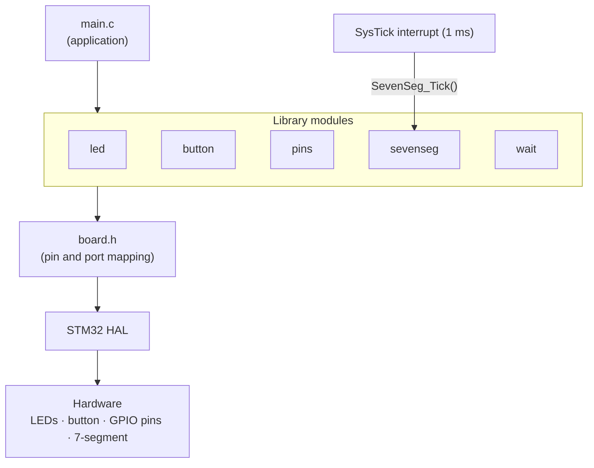

# STM32 Board Support Library (HAL-based)

A small, modular C library for driving common board peripherals on the
**STM32F4 Discovery (STM32F407G-DISC1)**, built on top of the STM32 HAL.
Application code talks to simple functions such as `LED_On(LED_GREEN)` or
`Button(BUTTON_1, 0)`; all hardware details live in a single file, `board.h`.

## Demo

<!-- Drag and drop the demo video here in the GitHub editor -->

The demo shows all four modules running together:

- **7-segment:** shows "3", blinking with a 1 s period (500 ms on), driven by the SysTick interrupt
- **Pins:** software square wave on PB0, measured with an oscilloscope
- **Button + LED:** pressing and releasing the blue user button lights the green LED for 300 ms

## Architecture



- **Application** code uses only the module functions and enums; it never touches HAL or pin numbers.
- **Each module** keeps a lookup table that maps an index (e.g. `LED_GREEN`) to a port and pin.
- **`board.h`** is the only place that knows which physical pin is used for what.
- **SysTick** (already running at 1 ms after `HAL_Init()`) drives the 7-segment blinking, so it keeps running while the main loop does other work.

## Modules

| Module | Functions | Notes |
|---|---|---|
| `led` | `LED_Init()`, `LED_On(led)`, `LED_Off(led)` | 4 on-board LEDs (PD12-PD15) |
| `button` | `Buttons_Init()`, `Button(button, min_ms)` | Returns 1 after a press of at least `min_ms` (min. 20 ms, debounce) and release |
| `pins` | `Pins_Init()`, `Pin_On(pin, mode)`, `Pin_Off(pin)` | 4 general-purpose pins; each call can set the pin as input or output |
| `sevenseg` | `SevenSeg_Init()`, `SevenSeg_On(pattern, period_ms, on_ms)`, `SevenSeg_Off()` | Single digit, blinking handled in the SysTick interrupt; supports common anode and common cathode |
| `wait` | `Wait(ms)` | Blocking delay, wraps `HAL_Delay` |

### 7-segment pattern

```
bit:     7   6   5   4   3   2   1   0
segment: dp  g   f   e   d   c   b   a
```

Example: `SevenSeg_On(0b01001111, 1000, 500)` shows "3" (segments a, b, c, d, g)
for 500 ms of every 1 s, as in the demo.
Passing `period_ms = 0` keeps the pattern on continuously instead of blinking.

## Usage example

```c
HAL_Init();
LED_Init();
Pins_Init();
Buttons_Init();
SevenSeg_Init();

SevenSeg_On(0b01001111, 1000, 500);   // "3", 1 s period, 500 ms on

while (1)
{
    Pin_On(PIN_1, OUT);               // PB0 high
    Wait(1);
    Pin_Off(PIN_1);                   // PB0 low
    Wait(1);

    if (Button(BUTTON_1, 0)) {        // on press and release
        LED_On(LED_GREEN);
        Wait(300);
        LED_Off(LED_GREEN);
    }
}
```

The 7-segment also needs one line in the SysTick handler (`stm32f4xx_it.c`):

```c
void SysTick_Handler(void)
{
    HAL_IncTick();
    SevenSeg_Tick();
}
```

## Hardware connections

| Function | STM32 pin | Notes |
|---|---|---|
| LEDs (green, orange, red, blue) | PD12, PD13, PD14, PD15 | On-board |
| Button 1 | PA0 | On-board blue button, external pull-down |
| PIN_1 .. PIN_4 | PB0, PB1, PB11, PB12 | Free pins on the Discovery board |
| 7-segment a .. g, dp | PE8 .. PE15 | Each through a 330 Ω resistor |
| 7-segment common | 3V (common anode) or GND (common cathode) | Set `SEVENSEG_COMMON_ANODE` in `board.h` |

Tested with a KPS-5161BS (common anode) display.

## Project structure

```
Core/
├── Inc/
│   ├── board.h        pin and port mapping
│   ├── led.h
│   ├── button.h
│   ├── pins.h
│   ├── sevenseg.h
│   └── wait.h
└── Src/
    ├── main.c         demo application
    ├── led.c
    ├── button.c
    ├── pins.c
    ├── sevenseg.c
    ├── wait.c
    └── stm32f4xx_it.c SysTick hook for the 7-segment
```

## Build

- STM32CubeIDE 2.2.0, project generated with STM32CubeMX
- HAL package: STM32Cube FW_F4 V1.28.3
- Board: STM32F407G-DISC1, programmed via the on-board ST-LINK

## Known limitations

- **Software timing:** the PB0 square wave is generated with `Wait()`, so its period
  varies slightly (`HAL_Delay` has 1 ms resolution, and the SysTick interrupt
  briefly pauses the loop). A hardware timer in PWM mode would give a stable signal.
- **Blocking button:** `Button()` waits while the button is held, so the main loop
  pauses during a press.
- **Single digit:** the 7-segment driver supports one digit; multiplexing
  several digits is not implemented.
